# Mini-Lab 2: Dynamic Office Nameplate
## UML Class Diagram

This diagram represents the object-oriented design of the Dynamic Office Nameplate system. It illustrates the employee inheritance hierarchy, polymorphism, controller and view architecture, and hardware components.

```mermaid
classDiagram
    direction TB

    class Employee {
        +name: String
        +phone: String
        +position: String
        +email: String
        +availability: String
        +__init__(name, phone, position, email, availability)
        +get_details(): String
        +get_availability(): String
        +cycle_availability(): void
    }

    class Faculty {
        +courses: String
        +office_hours: String
        +__init__(name, phone, position, email, courses, office_hours)
        +get_details(): String
        +get_availability(): String
    }

    class Staff {
        +get_details(): String
    }

    class Administrator {
        +calendar: Calendar
        +__init__(name, phone, position, email, calendar)
        +get_availability(): String
        +cycle_availability(): void
    }

    class StudentWorker {
        +supervisor: String
        +__init__(name, phone, position, email, supervisor)
        +get_details(): String
    }

    Employee <|-- Faculty
    Employee <|-- Staff
    Employee <|-- Administrator
    Employee <|-- StudentWorker

    class Calendar {
        +statuses: List
        +start_time: int
        +__init__()
        +get_availability(): String
    }

    Administrator o-- Calendar : uses

    class NameplateController {
        +employees: List~Employee~
        +view: NameplateView
        +buzzer: PassiveBuzzer
        +button_handler: NameplateButtonHandler
        +current_index: int
        +current_page: int
        +last_page_change: int
        +page_interval: int
        +__init__(employees, view, buzzer, button_handler)
        +get_current_employee(): Employee
        +previous_employee(): void
        +next_employee(): void
        +change_availability(): void
        +play_sound(): void
        +refresh(): void
        +run(): void
    }

    NameplateController "1" o-- "1..*" Employee : manages
    NameplateController "1" o-- "1" NameplateView : uses
    NameplateController "1" o-- "1" PassiveBuzzer : uses
    NameplateController "1" o-- "1" NameplateButtonHandler : uses

    class NameplateView {
        +display: LCDDisplay
        +lightstrip: LightStrip
        +__init__(display, lightstrip)
        +show_employee(employee, page): void
        +show_status_light(status): void
    }

    NameplateView o-- LCDDisplay : uses
    NameplateView o-- LightStrip : uses

    class NameplateButtonHandler {
        +previous_pressed: Boolean
        +next_pressed: Boolean
        +availability_pressed: Boolean
        +__init__()
        +buttonPressed(name): void
        +buttonReleased(name): void
    }

    class Button {
        +__init__(pin, name, handler, lowActive)
        +isPressed(): Boolean
        +setHandler(handler): void
    }

    Button "3" --> "1" NameplateButtonHandler : sends events

    class Display {
        +reset(): void
        +clear(): void
        +showNumber(number): void
        +showText(text): void
        +scroll(text, speed): void
    }

    class LCDDisplay {
        +__init__(sda, scl)
        +reset(): void
        +clear(line): void
        +showNumber(number, row, col): void
        +showNumbers(num1, num2, colon, row, col): void
        +showText(text, row, col): void
        +addShape(position, shapearray): void
        +scroll(text, row, speed, skip): void
    }

    Display <|-- LCDDisplay

    class Light {
        +__init__(pin, name)
        +on(): void
        +off(): void
        +flip(): void
        +blink(delay, times): void
        +isOn(): Boolean
    }

    class LightStrip {
        +__init__(pin, name, numleds, brightness)
        +on(): void
        +off(): void
        +flip(): void
        +setColor(color, numPixels): void
        +setPixel(pixelno, color, show): void
        +show(): void
        +setBrightness(brightness): void
    }

    Light <|-- LightStrip

    class Buzzer {
        +__init__(pin, name)
        +beep(tone, duration): void
        +play(tone): void
        +stop(): void
    }

    class PassiveBuzzer {
        +__init__(pin, name)
        +play(tone): void
        +stop(): void
        +setVolume(volume): void
    }

    Buzzer <|-- PassiveBuzzer

    class I2cLcd {
        +__init__(i2c, i2c_addr, num_lines, num_columns)
        +hal_write_command(cmd): void
        +hal_write_data(data): void
    }

    class LcdApi {
        +__init__(num_lines, num_columns)
        +clear(): void
        +move_to(cursor_x, cursor_y): void
        +putchar(char): void
        +putstr(string): void
        +custom_char(location, charmap): void
    }

    LcdApi <|-- I2cLcd
    LCDDisplay ..> I2cLcd : creates I2C driver
```

