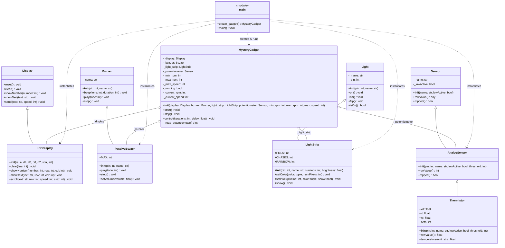

# PicoLibrary UML Class Diagram

This document contains the UML class diagram for the final implementation of the **MysteryGadget** system, showing `main.py`, `MysteryGadget.py`, and the underlying hardware component hierarchies from `PicoLibrary`.

